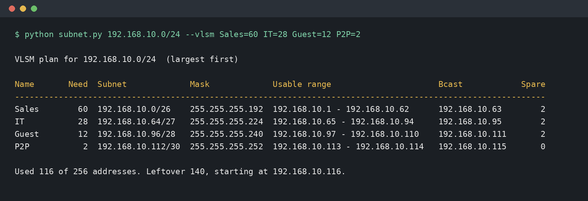
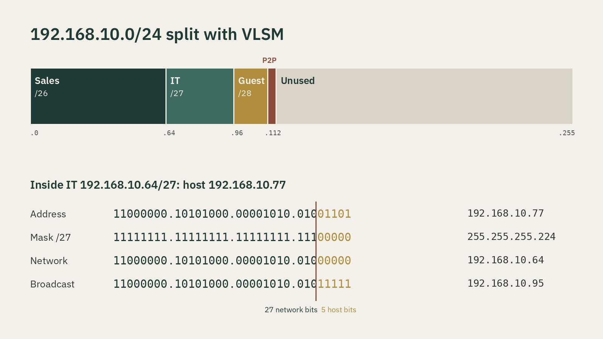

# Subnet Calculator

A Python IPv4 subnet calculator that shows the binary math behind each answer. I built it after my Network+ course at Grossmont College. Every result is cross-checked against Python's `ipaddress` module.



## Features
- **Inspect** an address/prefix: network, broadcast, first and last usable host, mask (dotted and binary), wildcard, usable hosts, block size, class, and whether it's private (RFC 1918).
- **VLSM planning:** give it a base network and host counts. It allocates subnets largest-first, prints a table, reports leftover space, and tells you when the requirements don't fit.
- **Quiz mode:** random practice questions with answers.

No dependencies beyond the standard library (pytest for tests). Python 3.10+.

## Usage
```bash
python subnet.py 192.168.10.37/27
python subnet.py 192.168.10.0/24 --vlsm Sales=60 IT=28 Guest=12 P2P=2
python subnet.py --quiz 10            # interactive
python subnet.py --quiz 5 --answers   # just print questions and answers
python -m pytest -q
```

## Example
```
$ python subnet.py 192.168.10.37/27
  IP       11000000.10101000.00001010.00100101
  Mask AND 11111111.11111111.11111111.11100000
  Network  11000000.10101000.00001010.00100000  = 192.168.10.32
  Bcast    11000000.10101000.00001010.00111111  = 192.168.10.63  (host bits set to 1)

Network          192.168.10.32/27
Subnet mask      255.255.255.224
Wildcard mask    0.0.0.31
First usable     192.168.10.33
Last usable      192.168.10.62
Host bits        5  -> 2^5 = 32 addresses, 30 usable
Block size       32 (octet 4)
```

```
$ python subnet.py 192.168.10.0/24 --vlsm Sales=60 IT=28 Guest=12 P2P=2
Name       Need  Subnet             Mask             Usable range                      Bcast            Spare
Sales        60  192.168.10.0/26    255.255.255.192  192.168.10.1 - 192.168.10.62      192.168.10.63        2
IT           28  192.168.10.64/27   255.255.255.224  192.168.10.65 - 192.168.10.94     192.168.10.95        2
Guest        12  192.168.10.96/28   255.255.255.240  192.168.10.97 - 192.168.10.110    192.168.10.111       2
P2P           2  192.168.10.112/30  255.255.255.252  192.168.10.113 - 192.168.10.114   192.168.10.115       0

Used 116 of 256 addresses. Leftover 140, starting at 192.168.10.116.
```



## The math
- **Mask:** a /n prefix means n one-bits followed by 32 − n zero-bits. For /27 that's `11111111.11111111.11111111.11100000` = 255.255.255.224.
- **Network address** = IP AND mask, which clears the host bits.
- **Broadcast** = network OR wildcard (the inverted mask), which sets every host bit to 1.
- **Usable hosts** = 2^h − 2, where h = 32 − n. You subtract the network and broadcast addresses. /31 (point-to-point, RFC 3021) and /32 are special cases.
- **Block size (magic number)** = 256 − the mask value in the octet where the mask stops being 255. For a /27 that's 256 − 224 = 32, so subnets start at .0, .32, .64, and so on.
- **VLSM:** sort the requirements largest-first and give each one the smallest prefix where 2^h − 2 ≥ hosts. Each block then starts on a multiple of its own size, so nothing overlaps and the space doesn't fragment.
